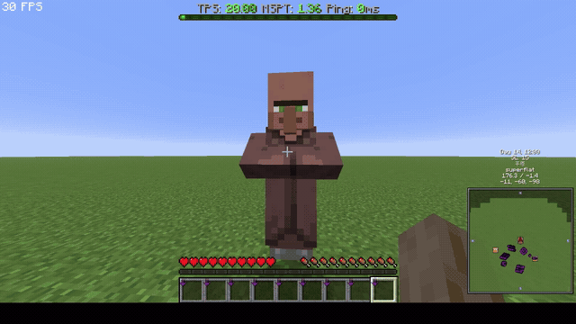

# SS Paste

スクショや画像をMinecraftのチャットへ直接貼り付けるMODです。画像を対応ホストへアップロードしてURLを挿入し、F2スクショをクリップボードへコピーし、チャット内の画像URLにホバーするとプレビューします。

## 機能

- チャット欄で `Ctrl+V` / `Cmd+V` すると画像をアップロードし、完了時にURLを挿入
- F2スクショを自動でシステムクリップボードへコピー（F1でHUDを消したものも含む）
- チャット内の画像URLにホバーでプレビュー、クリックでブラウザ表示
- Imgur / Gyazo / ImgBB / gzo.ai の拡張子なしページURLをOGPから解決
- Imgurのアルバム／ギャラリーはClient-ID設定時に最大4枚をグリッド表示
- アップロード履歴タブ（画像URL＋削除リンク）とローカルHTMLページ
- 選択したホストが失敗した場合はgzo.aiへ自動フォールバック

## アップロード先

| ホスト | 備考 |
| --- | --- |
| **gzo.ai**（デフォルト） | キー不要、24時間で消える、削除リンクあり |
| ImgBB | 無料APIキー、恒久、削除URLあり |
| Imgur | 既存のClient-IDのみ |
| Gyazo | アクセストークン |
| Catbox | キー不要 |

## 前提

- Minecraft 26.3
- Fabric Loader 0.20.1+
- Fabric API 0.165.0+26.3
- Java 25
- Quilt: Quilt Loader + Quilted Fabric API（Fabric API互換。Quiltでの実機確認は未実施）
- 任意: Mod Menu + Cloth Config（設定画面を使う場合）

## 注意

- gzo.aiの画像は24時間で消えます。選択したホストが失敗した場合はgzo.aiへフォールバックします。
- 削除リンクは秘密情報です。`config/sspaste-history.json` / `.html` はローカルのみで、共有しないでください。
- Mojang Studios、Microsoft、Imgur、Gyazo / Helpfeel、ImgBB、gzo.ai、Catboxとは関係ありません。

## リンク

- ソース: https://github.com/Taikin12/sspaste
- Issues: https://github.com/Taikin12/sspaste/issues
