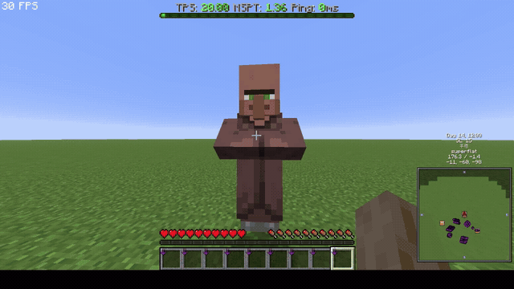

# SS Paste

Paste screenshots and images directly into Minecraft chat. SS Paste uploads the
image to a supported host, inserts the URL, copies F2 screenshots to the
clipboard, and previews image links when you hover them.

## Features

- Paste an image into chat with `Ctrl+V` / `Cmd+V`; the URL is inserted when the upload finishes.
- F2 screenshots are copied to the system clipboard automatically, including clean F1/HUD-hidden screenshots.
- Hover image URLs in chat for a preview; click to open in the browser.
- Imgur / Gyazo / ImgBB / gzo.ai viewer URLs without a file extension are resolved via OGP.
- Imgur albums/galleries show up to 4 images in a grid when a Client-ID is configured.
- Upload history tab with image URLs and delete links, plus a full local HTML page.
- Automatic fallback to gzo.ai if the selected uploader fails.

## Upload hosts

| Host | Notes |
| --- | --- |
| **gzo.ai** (default) | No key, expires after 24 hours, delete link |
| ImgBB | Free API key, permanent, delete URL |
| Imgur | Existing Client-ID only |
| Gyazo | Access token |
| Catbox | No key; uploads may be paused |

## Requirements

- Minecraft 26.3
- Fabric Loader 0.20.1+
- Fabric API 0.165.0+26.3
- Java 25
- Quilt: Quilt Loader + Quilted Fabric API (Fabric API-compatible; not tested on Quilt)
- Optional: Mod Menu + Cloth Config for the in-game config screen

## Notes

- gzo.ai uploads expire after 24 hours. Catbox may be paused; the mod falls back to gzo.ai on failure.
- Delete links are secrets. `config/sspaste-history.json` and `.html` are local; do not share them.
- Not affiliated with Mojang Studios, Microsoft, Imgur, Gyazo / Helpfeel, ImgBB, gzo.ai, or Catbox.

## Links

- Source: https://github.com/Taikin12/sspaste
- Issues: https://github.com/Taikin12/sspaste/issues
- Japanese README: https://github.com/Taikin12/sspaste/blob/main/README.ja.md
