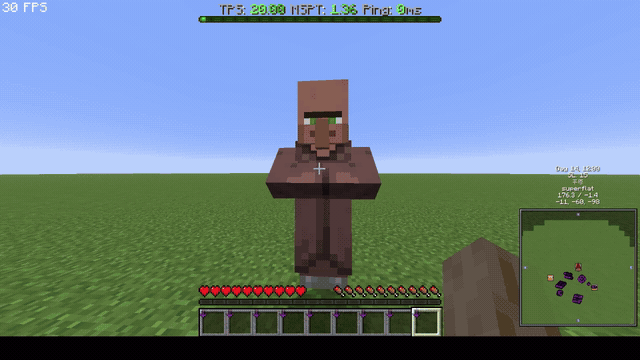

# SS Paste

[English](README_EN.md) | 日本語

Minecraft 26.3 用のクライアントサイド Fabric MOD です。チャット欄で `Ctrl+V`（Mac は `Cmd+V`）すると、クリップボードの画像をアップロードして URL を入力欄に挿入します。F2 スクリーンショット（F1 で HUD を消したものも含む）は自動でシステムクリップボードにもコピーされます。



- クリップボードにテキストがある場合は、通常のテキスト貼り付けを優先します。
- ビットマップ画像（`DataFlavor.imageFlavor` / `image/png`）と画像ファイルに対応しています。
- アップロードはバックグラウンドで実行し、完了時にカーソル位置へ URL を挿入します。チャットを閉じていた場合は URL をクリップボードにコピーしてチャットに表示します。
- F2 スクリーンショットをクリップボードへコピーするので、F1 のきれいなスクショをそのまま貼り付けられます。
- チャット内の画像 URL にホバーするとツールチップでプレビューします（`showChatImagePreviews`、デフォルト ON）。

## アップロード先

| `uploader` | 動作 |
| --- | --- |
| `catbox`（デフォルト） | catbox.moe（トークン不要） |
| `auto` | Imgur 設定時は Imgur → Gyazo → ImgBB → catbox.moe |
| `gyazo` | Gyazo（アクセストークン） |
| `imgbb` | ImgBB（API キー） |
| `gzo` | gzo.ai 匿名（キー不要、24 時間で消える） |
| `imgur` | Imgur（既存の Client-ID がある場合のみ） |

Imgur は新規 Client-ID 登録が停止しているため、既存の Client-ID が必要です。

- **Gyazo**: <https://gyazo.com/oauth/applications> でアプリを作成し、アクセストークンを発行します。画像は Gyazo アカウントに保存されます。
- **ImgBB**: <https://api.imgbb.com/> で無料 API キーを取得します。アップロードは恒久的です。
- **gzo.ai**: デフォルトのアップロード先。キー不要で、24 時間で消えます（ログイン時の 7 日保存は未実装）。削除リンクも記録されます。
- **imgbox**: 公開アップロード API がないため非対応です。
- **Catbox**: キー不要ですが、現在アップロード停止中の場合があります。その場合はgzo.aiを使ってください。

設定ファイル: `config/sspaste.json`（初回起動時に生成）。Mod Menu と Cloth Config が入っている場合は **Mod Menu > SS Paste > Config** からも設定できます。画面はゲーム言語（日本語/英語）に追従し、Gyazo トークン取得へのリンクも表示します。

```json
{
  "uploader": "gzo",
  "imgurClientId": "",
  "gyazoAccessToken": "",
  "imgbbApiKey": "",
  "maxUploadMegabytes": 10,
  "showChatFeedback": true,
  "copyScreenshotToClipboard": true,
  "showChatImagePreviews": true,
  "chatImagePreviewWidth": 160,
  "chatImagePreviewHeight": 100,
  "chatImageTextureWidth": 1280,
  "chatImageTextureHeight": 720
}
```

環境変数でも設定できます（旧 `CHATIMAGEUPLOADER_*` / `CHATIMGUR_*` も読みます）。

- Imgur Client-ID: `SSPASTE_CLIENT_ID`
- Gyazo: `SSPASTE_GYAZO_TOKEN`
- ImgBB: `SSPASTE_IMGBB_API_KEY`

## チャット画像プレビュー

Imgur / Gyazo / ImgBB / gzo.ai / Catbox の直リンクと、拡張子なしのページ URL に対応しています。ページ URL は OGP（`og:image`）や既知の URL パターンから実画像を解決します。URL をクリックするとブラウザで開きます。

Imgur のアルバム／ギャラリーは、Client-ID が設定されている場合に最大 4 枚を 2x2 グリッドで表示します（5 枚以上は「+N」）。認証情報がない場合はカバー画像 1 枚のみです。

HTTPS のみ、最大 8 MB。プレビュー画像は高解像度テクスチャ（デフォルト 1280x720）として取得し、小さい表示サイズ（デフォルト 160x100）にリニアフィルタで縮小します。表示サイズとテクスチャ解像度は設定画面で個別に変更できます（`chatImagePreviewWidth` / `chatImagePreviewHeight`、`chatImageTextureWidth` / `chatImageTextureHeight`）。テクスチャ解像度を上げるほどシャープになりますが、メモリ使用量が増えます。プレビュー自体は `showChatImagePreviews` で無効化できます。

## 免責

この MOD は Mojang Studios、Microsoft、Imgur、Gyazo / Helpfeel、ImgBB、gzo.ai、Catbox とは関係ありません。各製品名・ロゴ・商標はそれぞれの所有者に帰属します。

## プライバシー

アップロードした画像は選択した第三者のホストに送信され、公開 URL になります。トークンや API キーは `config/sspaste.json` にローカル保存され、選択したホストにのみ送信されます。アップロード履歴（画像URL・削除リンク）も `config/` にローカル保存されます。チャットプレビューは対応ホストから画像を取得します。作者にデータは送信されません。

## アップロード履歴

アップロードに成功するたびに、画像URLと削除リンク（取得できる場合）をローカルへ保存します。

- `config/sspaste-history.json` — 履歴データ
- `config/sspaste-history.html` — ブラウザで見る履歴ページ

**Mod Menu > SS Paste > Config** の「アップロード履歴」タブに最新20件を表示します。画像URLと削除リンクはクリックで開けます。全件はタブ先頭のHTMLページリンクから開けます。

- Imgur / ImgBB / gzo.ai: 削除リンクを記録
- Gyazo: 画像ページを記録（削除はGyazo上で）
- Catbox: 削除リンクなし

**削除リンクは秘密情報です。** `sspaste-history.json` / `.html` を他人と共有しないでください。

## 前提

- Minecraft 26.3
- Fabric Loader 0.20.1+
- Fabric API 0.165.0+26.3
- Java 25
- Mod Menu 21.0.0 / Cloth Config 26.3.159+（設定画面を使う場合。なくても `config/sspaste.json` で設定できます）

## 注意

- アップロードした画像は公開 URL になります。
- `maxUploadMegabytes` を超える画像はアップロード前に縮小されます（PNG）。

## ビルド

```sh
./gradlew build
# -> build/libs/sspaste-3.3.0.jar
```
