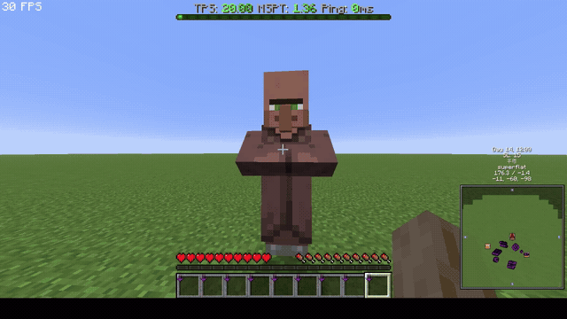

# SS Paste

[日本語](README.md) | English

SS Paste is a client-side Fabric mod (Minecraft 26.3). Paste an image into the chat box with
`Ctrl+V` (or `Cmd+V`): the image is uploaded and its URL is inserted into the
chat input. F2 screenshots (including clean screenshots taken with F1) are also
copied to the system clipboard automatically.



- Text paste is unchanged: if the clipboard contains plain text, the normal
  text paste happens.
- Images copied as a bitmap (`DataFlavor.imageFlavor` / `image/png`) or as an
  image file are supported.
- The upload runs in the background; the URL is inserted at the cursor when it
  finishes. If the chat screen was closed meanwhile, the URL is copied to the
  clipboard and shown in chat.
- F2 screenshots are copied to the clipboard, so you can take a clean F1
  screenshot and immediately paste it into chat.
- Hover an image URL in chat to show a thumbnail preview in a tooltip
  (`showChatImagePreviews`, default on).

## Hosts

| config `uploader` | behaviour |
| ----------------- | --------- |
| `catbox` (default) | catbox.moe (no token required) |
| `auto`            | Gyazo if a token is set, otherwise ImgBB if an API key is set, otherwise catbox.moe |
| `gyazo`           | Gyazo (access token) |
| `imgbb`           | ImgBB (API key) |
| `gzo`             | gzo.ai anonymous (no key, expires after 24 hours) |
| `imgur`           | Imgur (existing Client-ID only) |

Imgur still works if you already have a Client-ID; new Client-ID registration
is currently closed.

Gyazo requires an **access token**: create an application at
<https://gyazo.com/oauth/applications> and generate one. Uploads are saved to
your Gyazo account.

ImgBB requires a **free API key** from <https://api.imgbb.com/>. Uploads are
permanent.

gzo.ai works anonymously without a key and is selectable explicitly. Uploads
expire after 24 hours (the logged-in 7-day mode is not implemented).

imgbox has no public upload API, so it is not supported for automatic upload.

Config file: `config/sspaste.json` (created on first launch). If Mod Menu
and Cloth Config are installed, the same settings are available from
**Mod Menu > SS Paste > Config**. The screen follows the game
language (English/Japanese) and includes a clickable Gyazo token link.

```json
{
  "uploader": "catbox",
  "imgurClientId": "",
  "gyazoAccessToken": "",
  "imgbbApiKey": "",
  "maxUploadMegabytes": 10,
  "showChatFeedback": true,
  "copyScreenshotToClipboard": true,
  "showChatImagePreviews": true,
  "chatImagePreviewWidth": 160,
  "chatImagePreviewHeight": 100,
  "chatImageTextureWidth": 1280,
  "chatImageTextureHeight": 720
}
```

The Imgur Client-ID can also come from `SSPASTE_CLIENT_ID` or
`IMGUR_CLIENT_ID`. The Gyazo token can come from `SSPASTE_GYAZO_TOKEN` or
`GYAZO_ACCESS_TOKEN`. The ImgBB key can come from `SSPASTE_IMGBB_API_KEY` or
`IMGBB_API_KEY`.

## Chat image previews

Direct image URLs and extensionless viewer pages from Imgur, Gyazo, ImgBB,
gzo.ai, and Catbox are previewed when you hover over them in chat. Viewer pages are resolved to the actual image
via Open Graph tags / known URL patterns. Clicking the URL still opens it in
the browser. Imgur albums/galleries with a configured Client-ID show up to 4 images in a
2x2 grid (with "+N" for the rest); without an Imgur Client-ID only the cover
image is previewed. Only HTTPS URLs are loaded, up
to 8 MB; previews are
downloaded/scaled to a high-resolution texture (1280x720 by default) and drawn
at a smaller display size (160x100 by default) with linear filtering. Both are
separately adjustable in the config screen (`chatImagePreviewWidth`/`Height`
for the display, `chatImageTextureWidth`/`Height` for the texture resolution).
Higher texture resolution looks sharper but uses more memory. Disable previews
entirely with `showChatImagePreviews`.

## Disclaimer

This mod is not affiliated with Mojang Studios, Microsoft, Imgur, Gyazo /
Helpfeel, ImgBB, gzo.ai, or Catbox. All product names, logos, and trademarks are
the property of their respective owners.

## Privacy

Images are sent to the selected third-party host when you upload them and become
publicly accessible URLs. Tokens and API keys are stored locally in
`config/sspaste.json` and are only sent to the selected host. The upload
history (image URLs and delete links) is also stored locally under `config/`.
Chat previews fetch image URLs from the supported hosts; no data is sent to the
mod author.

## Migration

The mod id changed to `sspaste`. An existing `config/chatimageuploader.json`
or `config/chatimgur.json` is copied to `config/sspaste.json` automatically.
Remove old `chatimageuploader-*.jar` / `chatimgur-*.jar` files from the mods
folder to avoid duplicates.

## Upload history

After each successful upload, the mod saves the image URL and (when available)
the delete link locally:

- `config/sspaste-history.json` — history data
- `config/sspaste-history.html` — browser-viewable history page

Newest first, up to 200 entries. Open it from the "Upload history" link in
**Mod Menu > SS Paste > Config**, or open the HTML file directly.

- Imgur / ImgBB / gzo.ai: delete link is recorded
- Gyazo: image page is recorded (delete from Gyazo)
- Catbox: no delete link

**Delete links are secrets.** Do not share `sspaste-history.json` / `.html`.

## Notes

- Uploads are public. Anyone with the URL can view the image.
- Images larger than `maxUploadMegabytes` are downscaled (PNG) before upload.
- Requires Java 25 and Fabric API 0.165.0+26.3.

## Build

```sh
./gradlew build
# -> build/libs/sspaste-3.1.0.jar
```
